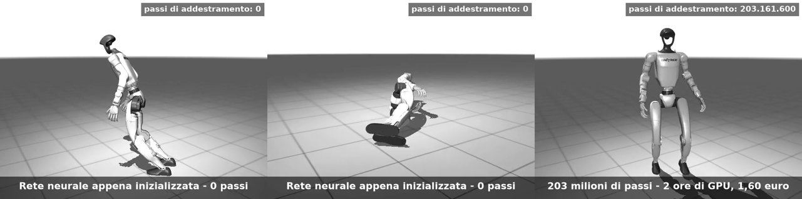
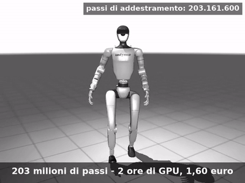

# Cadi, rialzati, cammina

**Un robot umanoide impara a camminare da solo, dentro un simulatore open source.**

[](https://colab.research.google.com/github/StefanoCapezzone/cadi-rialzati-cammina/blob/main/notebook/cadi_rialzati_cammina_tutorial.ipynb)
&nbsp;
&nbsp;



Materiale del talk di **Stefano Capezzone** al **Linux Day 2026** (Roma2LUG, Università di Roma Tor Vergata, 24 ottobre 2026).

Abbiamo preso il gemello digitale di un **Unitree G1** (umanoide vero: 1,32 m, ~35 kg, 29 articolazioni motorizzate) e gli abbiamo insegnato a camminare con il **reinforcement learning**. Nessuno gli spiega come si cammina: prova, cade, riceve un premio quando fa la cosa giusta e una penalità quando sbaglia. 8.192 copie del robot in parallelo su una GPU, **203 milioni di passi in 124 minuti, circa 1,60 € di GPU a noleggio**. Tutto il software è libero.

> *English summary:* talk material from Linux Day 2026 (Rome). We train a neural network policy that makes a simulated Unitree G1 humanoid walk, using PPO (Brax) on MuJoCo Playground / MuJoCo Warp, 203M steps in ~2 GPU hours. The repo contains a runnable Colab tutorial (Italian), the slides, the training videos, a CPU-only MuJoCo viewer that runs the trained policy in numpy, and all the scripts we used, including our reward-hacking experiments on teaching the robot to get up.

---

## Cosa trovi qui

| cartella | cosa c'è |
|---|---|
| [`notebook/`](notebook/) | **Il tutorial**: addestra il tuo G1 su Google Colab, dalla prima cella al video del robot che cammina. Pulsante qui sopra. |
| [`simulatore/`](simulatore/) | Visualizzatore MuJoCo **da tastiera, senza GPU**, con la nostra rete già addestrata: accendi/spegni il "cervello", comandalo con le frecce, spingilo e guardalo recuperare. |
| [`slide/`](slide/) | Le slide del talk in PDF (con un'appendice tecnica su PPO, iperparametri e bibliografia). |
| [`video/`](video/) | Le sei clip del talk: giorno zero, i primi passi, troppo veloce, cammina, il ghiaccio, cadute assortite. |
| [`addestramento/`](addestramento/) | Gli script che abbiamo usato davvero: addestramento, video delle fasi, cadute, montaggio delle clip, il robot che si rialza. |
| [`esperimenti/stickman/`](esperimenti/stickman/) | Il "riscaldamento": l'umanoide stilizzato di DeepMind Control Suite che impara a rialzarsi. |

```
cadi-rialzati-cammina/
├── notebook/cadi_rialzati_cammina_tutorial.ipynb
├── simulatore/          vis_g1.py · politica_g1.py · avvia.command · modello/ · pesi/
├── slide/               cadi_rialzati_cammina.pdf
├── video/               clip1 … clip6 (.mp4)
├── addestramento/       addestra_g1.py · train_loco.py · render_*.py · g1_falls.py · g1_getup*.py · …
├── esperimenti/stickman humanoid_getup.py · train_getup.py · render_stages.py
└── docs/                immagini del README
```

---

## Tre modi per provarlo

### 1. Addestra il tuo robot (Colab, nel browser)
Clicca **Open in Colab** qui sopra, scegli un runtime con GPU ed esegui le celle dall'alto in basso. Il notebook spiega ogni passaggio (osservazioni, ricompensa, PPO con le formule, iperparametri) e alla fine mostra le curve di apprendimento e i video della tua rete.

| modalità | GPU | passi | tempo indicativo |
|---|---|---|---|
| `prova` | anche CPU | 2.000 | pochi minuti: verifica che tutto funzioni |
| `veloce` | T4 (gratuita) | 50 M | ~1 ora *(stima)*: smette di cadere, comincia a camminare |
| `completo` | A100 / L4 / H100 | 200 M | ~1 ora su A100: cammina, curva, va di lato, regge le spinte |

### 2. Gioca con la rete già addestrata (sul tuo portatile, senza GPU)
```bash
cd simulatore
python3 -m venv .venv && .venv/bin/pip install -r requirements.txt
.venv/bin/python politica_g1.py      # prova senza grafica: deve camminare per 10 s
.venv/bin/mjpython vis_g1.py         # macOS (su Linux: .venv/bin/python vis_g1.py)
```
Tasti e istruzioni in [`simulatore/README.md`](simulatore/README.md).

### 3. Rifai i nostri esperimenti
Gli script in [`addestramento/`](addestramento/) sono quelli che abbiamo lanciato su Colab (A100), compresi i tre tentativi di insegnare al G1 a **rialzarsi** da terra: una piccola storia di *reward hacking*. Vedi [`addestramento/README.md`](addestramento/README.md).

---

## Come funziona, in breve

```
 comando "vai avanti a 0,5 m/s"
            │
            ▼
 ┌──────────────────────┐  50 volte al secondo   ┌───────────────────────┐  500 volte al secondo
 │  RETE NEURALE        │ ──────────────────────►│ CONTROLLO DEI GIUNTI  │──► motori ──► robot
 │  103 numeri → 29     │  29 posizioni obiettivo│ (PD)                  │
 └──────────────────────┘                        └───────────────────────┘
            ▲                                                                     │
            └────────────── sensori: inclinazione, rotazione, angoli ◄────────────┘
```

- **La rete** (MLP 512 → 256 → 128, ~225.000 parametri) riceve 103 numeri: velocità e rotazione del bacino, direzione della gravità, il comando, angoli e velocità dei 29 giunti, l'ultima azione e un "metronomo" per i passi. Restituisce 29 posizioni obiettivo, una per articolazione.
- **La ricompensa** premia il seguire velocità e rotazione richieste e i passi veri (piedi in aria, a tempo); penalizza cadute (−100), busto inclinato, piedi che scivolano, giunti a fine corsa e molto altro.
- **L'algoritmo** è PPO (*Proximal Policy Optimization*) di Brax, con gli iperparametri pubblicati da DeepMind per questo ambiente, senza ritocchi. Il critico vede informazioni "privilegiate" (216 numeri) che sul robot vero non ci sarebbero.
- **Domain randomization**: attriti, masse, posa e spinte cambiano a ogni episodio, perché il simulatore non è mai identico al mondo vero.

| milioni di passi | 0 | 30 | 35 | 50 | 91 | 117 | 203 |
|---|---|---|---|---|---|---|---|
| ricompensa media | −5,9 | −1,9 | −1,5 | 1,2 | 7,7 | 10,1 | 14,5 |
| durata degli episodi (su 1000) | 40 | 87 | 162 | 387 | 596 | 632 | ~750 |

*(valutazioni con comandi e spinte casuali; dettagli nell'appendice delle slide)*



### Rialzati: quando il robot fa quello che chiedi, non quello che intendi
Per insegnargli ad alzarsi da terra abbiamo scritto un ambiente su misura (`addestramento/g1_getup*.py`):
1. *"Ti premio se alzi il busto"* → impara a **sdraiarsi sui gomiti**, come in spiaggia.
2. *"Ti premio se stai in alto"* → impara a **sedersi composto**.
3. La diagnosi: con le azioni limitate a ±0,5 rad dalla posa in piedi **non poteva piegare abbastanza le ginocchia**. Con l'escursione completa e "una mano" che lo aiuta all'inizio e poi lo lascia (idea di HoST, 2025), dopo 450 milioni di passi **si alza in circa un secondo e resta in piedi**.

---

## Software e versioni

Tutto open source: [MuJoCo](https://mujoco.org) (fisica), [MuJoCo Warp](https://github.com/google-deepmind/mujoco_warp) (fisica su GPU), [JAX](https://github.com/jax-ml/jax), [Brax](https://github.com/google/brax) (PPO), [MuJoCo Playground](https://github.com/google-deepmind/mujoco_playground) (l'ambiente del G1), [MuJoCo Menagerie](https://github.com/google-deepmind/mujoco_menagerie) (il modello del robot). L'unica cosa non libera è la GPU a noleggio (Google Colab).

Versioni usate per l'addestramento: `playground 0.2.0 · brax 0.14.2 · jax 0.9.2 · flax 0.12.6 · MuJoCo 3.13 / Warp 1.17` (settembre 2026). Il visualizzatore funziona con `mujoco ≥ 3.10` (3.10.0 è l'ultima con ruote per Mac Intel).

## Limiti, detti chiaramente
- La rete **non è mai stata provata su un G1 vero**: il passaggio dalla simulazione alla realtà resta la parte più difficile.
- Nel visualizzatore la rete gira su MuJoCo CPU, mentre è stata addestrata su MuJoCo Warp (GPU): piccole differenze di fisica sono normali.
- Per rialzarsi il robot ha avuto bisogno di un aiuto (la "mano") nelle prime fasi dell'addestramento.

## Per approfondire
- Schulman et al., *Proximal Policy Optimization Algorithms*, 2017 — [arXiv:1707.06347](https://arxiv.org/abs/1707.06347)
- Schulman et al., *High-Dimensional Continuous Control Using Generalized Advantage Estimation*, ICLR 2016 — [arXiv:1506.02438](https://arxiv.org/abs/1506.02438)
- Rudin et al., *Learning to Walk in Minutes Using Massively Parallel Deep RL*, CoRL 2021 — [arXiv:2109.11978](https://arxiv.org/abs/2109.11978)
- Zakka et al., *MuJoCo Playground*, RSS 2025 — [arXiv:2502.08844](https://arxiv.org/abs/2502.08844)
- Bibliografia completa nell'ultima sezione del notebook e nell'appendice delle slide.

## Licenze
- **Codice** (cartelle `notebook/`, `simulatore/*.py`, `addestramento/`, `esperimenti/`): [MIT](LICENSE).
- **Slide, video, immagini e testi**: [Creative Commons Attribution 4.0 (CC BY 4.0)](LICENSE-CC-BY-4.0.md) — riusali liberamente citando *Stefano Capezzone, "Cadi, rialzati, cammina", Linux Day 2026*.
- **Componenti di terze parti**, con le loro licenze:
  - `simulatore/modello/*.xml`: dal modello del G1 di MuJoCo Playground (Google DeepMind, Apache-2.0, vedi `simulatore/modello/LICENSE_mujoco_playground_Apache-2.0.txt`);
  - `simulatore/modello/assets/*.STL`: mesh di Unitree Robotics via MuJoCo Menagerie (BSD-3-Clause, vedi `simulatore/modello/assets/LICENSE_Unitree_BSD-3-Clause.txt`);
  - `esperimenti/stickman/humanoid_getup.py` è una variante di `dm_control_suite/humanoid.py` di MuJoCo Playground (Apache-2.0).
- Unitree e G1 sono marchi di Unitree Robotics; questo progetto non è affiliato né approvato da Unitree o Google DeepMind.

## Contatti
Stefano Capezzone · stefano@capezzone.it · Roma2LUG
